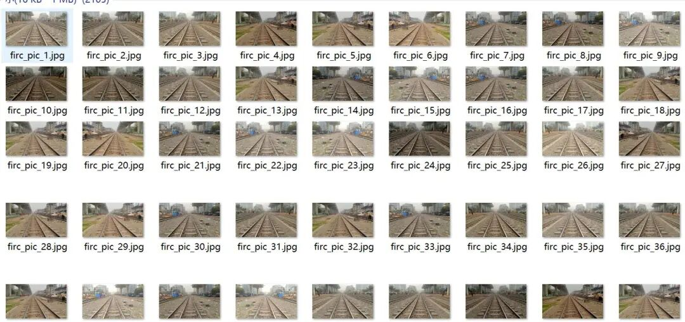
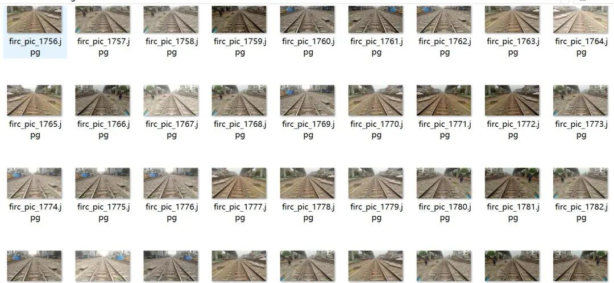
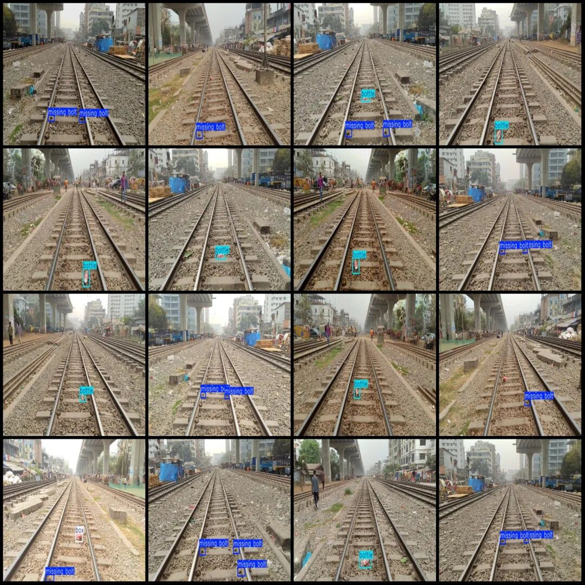
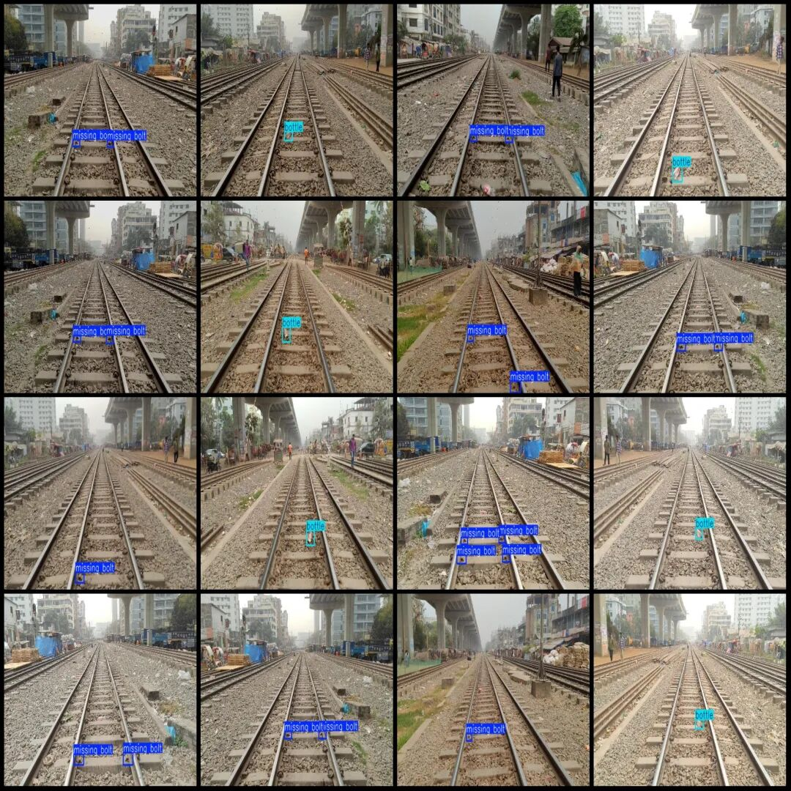

# Intelligent Railway Track Safety Bolt Missing Foreign Object Detection Dataset VOC+YOLO format with 2105 images in 3 categories with enhanced

Please note that the original images in the dataset are only about 240, with the rest being enhanced versions. They all depict a single scene. Please pay attention to the images.

Dataset format: Pascal VOC format + YOLO format (txt file without split path, only containing jpg images and corresponding VOC format xml files and yolo format txt files)

Number of images (number of jpg files): 2105

Number of annotations (number of xml files): 2105

Number of annotations (number of txt files): 2105

Label category count: 3

Label category names (Note that the order of categories in the YOLO format does not correspond to this, but is based on the labels folder's classes.txt): ["bottle", "box", "missing bolt"]

Number of boxes labeled in each category:

Bottle (bottle) Frames = 831

Box (box) Frames = 170

Missing bolt (bolt missing) Frames = 2663

Total frame count: 3664

Number of images per category:

Bottle (bottle) occupies a picture count = 831

Box (box) occupies 170 images.

Missing bolt (bolt missing) occupies 1409 images.

Image resolution: 640x360

Using labelImg:

Annotation rules: Draw a rectangle around the category.

Important Notice: The dataset does not have separate training, validation, and test sets; you need to partition them yourself.

Special : This dataset does not guarantee the accuracy of the trained models or weight files.

Image Preview:

Annotation example:

## Payment

Here is a pay link on Stripe ( https://buy.stripe.com/3cs8yP7sY87d0vu9AB ). Please contact me lonlonago@foxmail.com after funding $89, and I will send you a complete data files , thank you!

